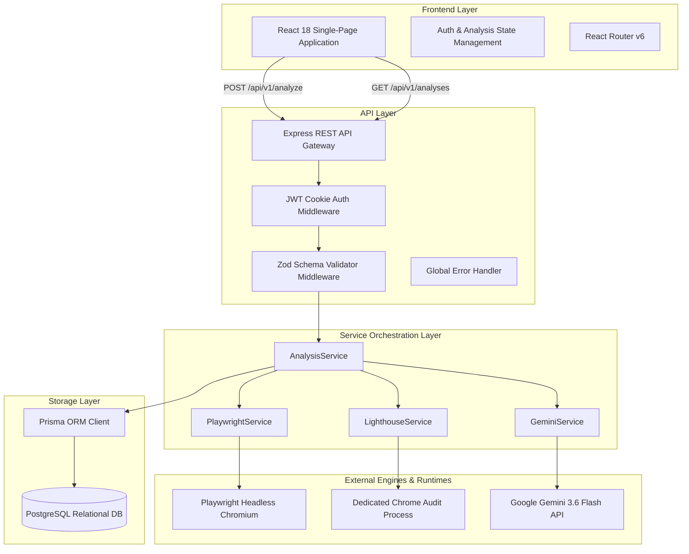

# High-Level Architecture Design (HLD)

## 1. System Overview

**UIVerdict** is an automated website UI/UX evaluation platform designed to perform automated audits on target web applications. Within a 60-second execution lifecycle, the platform captures high-resolution full-page screenshots, audits performance and accessibility metrics, computes an evidence-based global score, and uses Google Gemini AI to produce qualitative UI/UX critiques and recommendations.

---

## 2. Business Goals & Objectives

- **Automated UI/UX Assessment**: Eliminate subjective and slow design reviews by providing deterministic performance metrics and AI qualitative feedback.
- **Unified Forensic Dashboard**: Present raw performance indicators (Core Web Vitals) alongside high-level design critiques in a single interactive dashboard.
- **Authenticated Historical Auditing**: Allow users to track UI/UX quality across multiple domains, historical releases, and redesign cycles.

---

## 3. High-Level System Architecture

```
+-------------------------------------------------------------------------------+
|                                CLIENT LAYER                                   |
|                        React 18 Single-Page App (SPA)                         |
|                    Vite + Tailwind CSS + React Router v6                      |
+-------------------------------------------------------------------------------+
                                        |  HTTP REST / Cookie Auth
                                        v
+-------------------------------------------------------------------------------+
|                              APPLICATION LAYER                                |
|                        Node.js + Express API Gateway                          |
|                   Middleware: Helmet, CORS, JWT Auth, Zod                     |
+-------------------------------------------------------------------------------+
                                        |
                 +----------------------+----------------------+
                 |                      |                      |
                 v                      v                      v
+------------------+     +-------------------+     +--------------------+
| AUTOMATION       |     | AUDIT ENGINE      |     | COGNITIVE AI       |
| Playwright       |     | Lighthouse        |     | Google Gemini AI   |
| Headless Chrome  |     | Core Web Vitals   |     | GenAI Multimodal   |
+------------------+     +-------------------+     +--------------------+
         |                         |                         |
         +-------------------------+-------------------------+
                                   |
                     +-------------+-------------+
                     |                           |
         +-----------------------------------------------+
         | SINGLE SOURCE OF TRUTH PERSISTENCE LAYER      |
         | PostgreSQL + Prisma ORM                       |
         +-----------------------------------------------+
```

---

## 4. Architecture Diagram



---

## 5. Major Components

### 5.1 Frontend Application
- **Technology**: React 18, Vite, TypeScript, Tailwind CSS, Lucide Icons.
- **Role**: Provides the user interface for submitting URLs, visualizing real-time analysis progress, displaying forensic scorecards, and exploring historical evaluation archives.

### 5.2 Backend API Gateway
- **Technology**: Node.js, Express, TypeScript.
- **Role**: Manages HTTP routing (`/api/v1/*`), handles security headers (Helmet), manages CORS policies, parses cookies, and handles centralized exception formatting (`ApiError`).

### 5.3 Analysis Orchestration Engine (`AnalysisService`)
- **Role**: Coordinates the analysis lifecycle. It creates PostgreSQL records, triggers screenshot capture, executes Lighthouse audits, calls Gemini AI, saves complete results directly to PostgreSQL, and updates analysis statuses.

### 5.4 Browser Automation Engine (`PlaywrightService`)
- **Technology**: Playwright (Chromium).
- **Role**: Launches headless Chromium instances, configures desktop viewports (1280x800), navigates to target URLs, handles network timeouts, and captures full-page PNG screenshots.

### 5.5 Performance & Accessibility Audit Engine (`LighthouseService`)
- **Technology**: Lighthouse, `chrome-launcher`.
- **Role**: Spawns isolated Chrome processes on dynamic ports, executes automated audits for Performance, Accessibility, Best Practices, and SEO, and extracts Core Web Vitals (FCP, LCP, Speed Index, TBT, CLS, TTI).

### 5.6 Qualitative Reasoning Engine (`GeminiService`)
- **Technology**: `@google/genai` (`gemini-3.6-flash`).
- **Role**: Transmits audit evidence to Gemini AI with strict JSON Schemas, generating structured qualitative critiques, strengths, and areas for refinement.

### 5.7 Persistence Layer
- **Technology**: PostgreSQL, Prisma ORM.
- **Role**: Single source of truth storing relational entities (`User`, `Project`, `Analysis`), scalar metrics (Lighthouse scores, Web Vitals, overall UIVerdict score), and JSON structures for qualitative AI feedback.

---

## 6. End-to-End Request Flow

```mermaid
sequenceDiagram
    autonumber
    actor User as User / Analyst
    participant Client as React SPA
    participant API as Express API Server
    participant Orchestrator as AnalysisService
    participant PG as PostgreSQL (Prisma)
    participant PW as Playwright
    participant LH as Lighthouse
    participant AI as Gemini AI

    User->>Client: Input URL & Click ANALYZE
    Client->>API: POST /api/v1/analyze { url }
    API->>Orchestrator: analyzeUrl(url, userId)
    
    rect rgb(25, 25, 35)
        note right of Orchestrator: Phase 1: Database Initialization
        Orchestrator->>PG: createAnalysisTransaction() -> Status: PROCESSING
    end

    rect rgb(35, 25, 25)
        note right of Orchestrator: Phase 2: Screenshot Capture
        Orchestrator->>PW: captureScreenshot(url)
        PW-->>Orchestrator: Return ScreenshotResult (path, filename)
    end

    rect rgb(25, 35, 25)
        note right of Orchestrator: Phase 3: Performance Audit
        Orchestrator->>LH: runAudit(url)
        LH-->>Orchestrator: Return LighthouseMetrics
    end

    rect rgb(35, 35, 25)
        note right of Orchestrator: Phase 4: Holistic AI Evaluation
        Orchestrator->>AI: generateAnalysis(metrics, screenshot)
        AI-->>Orchestrator: Return AiAnalysis JSON (UIVerdict Score + Critique)
    end

    rect rgb(25, 35, 35)
        note right of Orchestrator: Phase 5: Complete PostgreSQL Persistence
        Orchestrator->>PG: saveAnalysisResult(metrics, aiAnalysis, status: COMPLETED)
        PG-->>Orchestrator: Return updated Analysis record
    end

    Orchestrator-->>API: Return AnalysisResponse JSON Payload
    API-->>Client: HTTP 200 OK
    Client->>Client: Progress = 100% -> Navigate to /report/:id
    Client-->>User: Render Forensic Scorecard & Critique
```



---

## 7. Data Architecture (PostgreSQL Single Source of Truth)

UIVerdict uses PostgreSQL + Prisma as the single persistence layer:

### Key Entities:
- `User`: Authenticated user accounts (`id`, `name`, `email`, `passwordHash`, `createdAt`, `updatedAt`).
- `Project`: Organizational grouping for analyses (`id`, `userId`, `name`, `createdAt`, `updatedAt`).
- `Analysis`: Comprehensive audit records:
  - Relational scalar columns: `id`, `projectId`, `userId`, `url`, `status`, `overallScore`, `verdictLabel`, Lighthouse scores, and Web Vitals.
  - JSON columns: `qualitativeCritique`, `strengths`, and `areasForRefinement`.
- **Temporary screenshot evidence**: A screenshot exists on local disk only for the active analysis and is removed after the pipeline completes or fails.

---

## 8. Authentication & Authorization

- **Session Architecture**: HTTP-only JWT cookies issued upon `/api/v1/auth/login` or `/api/v1/auth/register`.
- **Password Security**: Passwords salted and hashed via `bcryptjs`.
- **Middleware Control**:
  - `authMiddleware`: Enforces valid JWT token on protected endpoints (`GET /api/v1/analyses`, `GET /api/v1/auth/me`).
  - `optionalAuthMiddleware`: Extracts user identity if present (`POST /api/v1/analyze`), allowing unauthenticated guest scans while attaching registered scans to `req.user.id`.
- **User Ownership Isolation**: Database queries for user archives explicitly enforce `where: { userId: req.user.id }`.

---

## 9. Error Handling & Resiliency

- **Centralized Exception Standard**: Custom `ApiError` class extending native JavaScript `Error` with HTTP status codes and operational flags.
- **Lighthouse Retry Policy**: Performs up to 2 attempts for Lighthouse Chrome process execution to withstand temporary port binding or FCP timeouts.
- **Gemini Exponential Backoff**: Detects transient errors (429, 503, rate limits) and retries up to 3 times with exponential backoff delays ($2s, 4s, 6s$).
- **Server Timeout Extensions**: Express server socket timeouts (`timeout`, `requestTimeout`, `headersTimeout`) are set to **300,000 ms (5 minutes)** to support long-running analysis workflows.
- **Status Recovery**: If any step in the analysis pipeline throws an unhandled exception, the analysis status in PostgreSQL is updated to `FAILED`.

---

## 10. Scalability Considerations

### Current Architecture
The current version executes website analyses synchronously in-flight within Express request threads. While suitable for initial deployments, concurrency is naturally bounded by available host CPU and memory resources required for Chrome and Playwright processes.

### Future Improvements (Roadmap)
1. **Asynchronous Message Queue**: Transition from synchronous execution to an asynchronous job queue (e.g., Redis + BullMQ) with dedicated background worker processes.
2. **Horizontal Worker Scaling**: Decouple API web nodes from browser worker nodes, allowing Playwright and Lighthouse jobs to scale independently.
3. **Storage Offloading**: Migrate screenshot files from local disk (`temp/screenshots/`) to object storage (e.g., AWS S3 or Cloudflare R2).

---

## 11. Security Considerations

- **Secret Protection**: Secrets (`GEMINI_API_KEY`, `DATABASE_URL`, `JWT_SECRET`) are managed strictly through environment variables and excluded from version control via `.gitignore`.
- **CORS Protection**: Restricted to explicitly whitelisted origin domains (`FRONTEND_URL`).
- **HTTP Header Hardening**: Enforced via `helmet()` to guard against clickjacking, MIME sniffing, and cross-site scripting (XSS).
- **Injection Defense**: PostgreSQL inputs parameterized by Prisma ORM; incoming HTTP bodies sanitized via Zod validation.

---

## 12. Deployment Considerations

- **Node.js Environment**: Requires Node.js `>= 20.0.0`.
- **Browser Dependencies**: Headless Chromium binaries (`npx playwright install chromium`) and System Chrome libraries must be present on the host OS environment.
- **Process Management**: Recommended execution via PM2 or systemd services in production.
